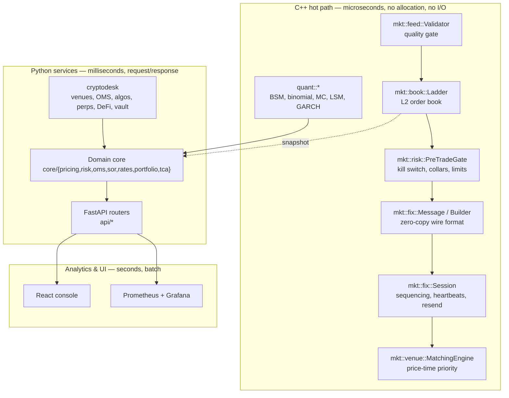
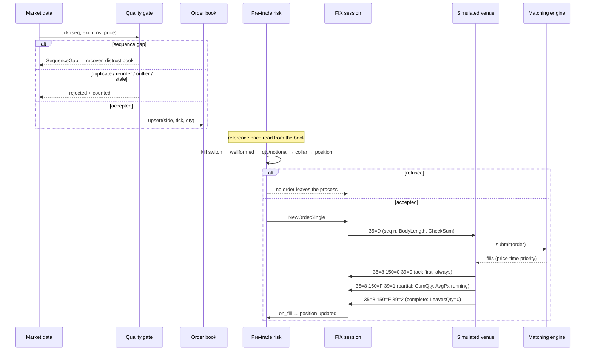
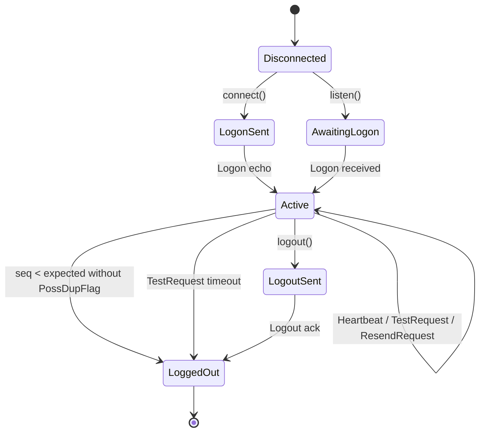

# Architecture

QuantGenLabs is a cross-asset trading, quant and risk platform. This document
describes what exists, how it is layered, and — equally important — what is
deliberately not built yet.

## Layering

Three tiers, separated by what their latency budget is:

The rule that keeps this honest: **nothing in the hot path performs I/O, takes a
lock, or allocates.** Kafka, PostgreSQL and a data lake belong in the warm and cold
tiers, never inside the feed handler. That is spec rule 9, and it is the reason the
C++ layer has no database client in it at all.

## Order lifecycle

Two things this diagram encodes that are easy to get wrong:

- **The ack precedes every fill.** A client that receives a Trade for an order it
  was never told the venue accepted cannot reconcile its blotter.
- **A gap suspends application processing.** Applying a later ExecutionReport
  before an earlier one corrupts position, so the session requests a resend and
  stops rather than processing out of order.

## FIX session state machine

The two edges straight from `Active` to `LoggedOut` are the interesting ones. Both
are cases where the connection is technically fine and the session is nonetheless
unusable: a sequence number going backwards without a duplicate claim means one
side's persisted state is wrong, and silence after a TestRequest means the peer is
gone even though TCP has not noticed.

## Sequence-number handling

The four cases, and why they are handled differently rather than as one
"bad sequence number" branch:

| Inbound | Meaning | Action |
|---|---|---|
| `seq == expected` | in sequence | process, advance |
| `seq > expected` | messages lost | ResendRequest; **suspend app processing** |
| `seq < expected`, no `43` | peer state is wrong | Logout — unrecoverable per spec |
| `seq < expected`, `43=Y` | normal replay during recovery | ignore quietly |

Note that market-data sequencing (`mkt::feed::Validator`) makes a further
distinction FIX does not need: a **duplicate** (same seq again — transport is
retransmitting) versus a **reorder** (older seq after a newer one — transport is
not preserving order). Both are dropped, but they are different diagnoses.

## Component map

| Path | What it is | Tests |
|---|---|---|
| `cpp/include/mkt/book/ladder.hpp` | L2 ladder: integer ticks, flat array, SoA, cached best | 13 |
| `cpp/include/mkt/feed/validator.hpp` | gap/duplicate/reorder/stale/outlier detection | 12 |
| `cpp/include/mkt/fix/message.hpp` | zero-copy FIX parse, allocation-free encode | 14 |
| `cpp/include/mkt/fix/session.hpp` | sequencing, heartbeats, resend, injected clock | 18 |
| `cpp/include/mkt/risk/pretrade.hpp` | kill switch, fat-finger, collars, position limits | 17 |
| `cpp/include/mkt/venue/matching_engine.hpp` | price-time priority, IOC/FOK, self-match prevention | 27 |
| `cpp/include/mkt/venue/fix_venue.hpp` | FIX ↔ matching translation, ExecutionReports | 16 |
| `cpp/include/quant/*` | BSM, binomial, MC, LSM, GARCH, SIMD exp, parallel | 9 |
| `backend/app/core/*` | pricing, risk, OMS, SOR, rates, portfolio, TCA | pytest + Hypothesis |
| `backend/cryptodesk/*` | crypto venues, OMS, algos, perps, DeFi, vault, wallet | pytest |
| `cpp/src/mkt_bench.cpp` | reproducible benchmark harness → JSON | run in CI |
| `cpp/src/lifecycle_demo.cpp` | the whole path, printed | run in CI |

**126 C++ tests**, 48 Python tests, 5 property tests and 3 math verifiers, all in
CI.

## Design decisions worth knowing

**Prices are integer ticks, never doubles.** A book keyed by `double` is a latent
correctness bug: 1.10 arrives from one venue as `1.0999999999999999` and from
another as `1.1000000000000001`, and they land on two different levels. Conversion
to display prices happens at the edges only, and it *rounds* — truncating there is
a classic off-by-one-tick bug.

**The order book is a flat array, not a tree.** A live instrument's price range is
bounded over a session, so the whole ladder fits in an array indexed by
`tick - floor`. Every update is an O(1) store rather than an O(log n) tree walk,
and the hot path allocates nothing.

**Time is injected into the session layer.** Every entry point takes `now_ns`, so
heartbeat, test-request and timeout behaviour is tested at exact intervals with no
sleeping. A session that reads its own clock can only be tested by waiting.

**Determinism is a property of the reduction order.** The parallel Monte Carlo
returns bitwise-identical prices at any thread count because per-block RNG
substreams are seeded from `(base_seed, block_index)` and partial sums are reduced
in block-index order. Floating-point addition is not associative, so a fixed
reduction order is what makes results reproducible rather than merely close.

**The matching engine is a test oracle, so it has no clocks, no randomness and no
threads.** The same inbound sequence always produces byte-identical fills.

## What is not built

Stated explicitly rather than implied by absence. See
[`gap-analysis.md`](gap-analysis.md) for the full assessment.

| Not present | Note |
|---|---|
| Kafka event backbone | Topic design and producer/consumer code not yet written. No broker available in the dev environment. |
| PostgreSQL | Operational store is SQLite. No schema migration path yet. |
| Databricks / Delta Lake | No bronze/silver/gold pipeline. |
| gRPC | REST and WebSocket only. |
| OpenTelemetry tracing | Prometheus metrics only; no distributed traces or correlation IDs. |
| Auth / RBAC | No authentication layer. Grafana is viewer-anonymous by deliberate choice for a portfolio deployment. |
| Redis | No caching tier. |
| Real venue connectivity | FIX targets the in-process simulated venue only, by design (spec rule 6). |

