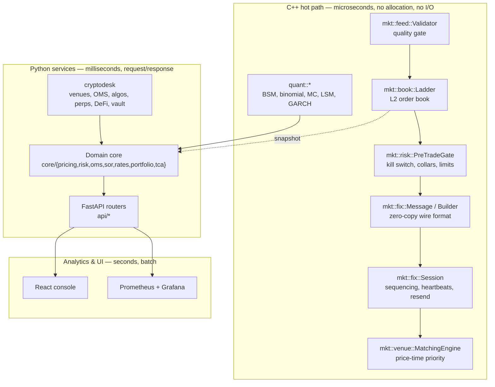
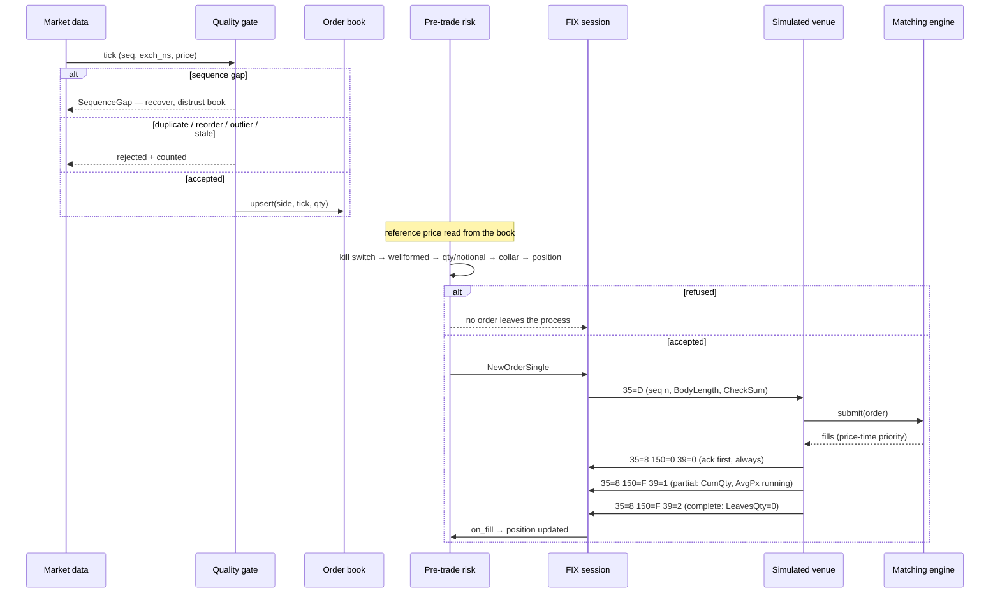
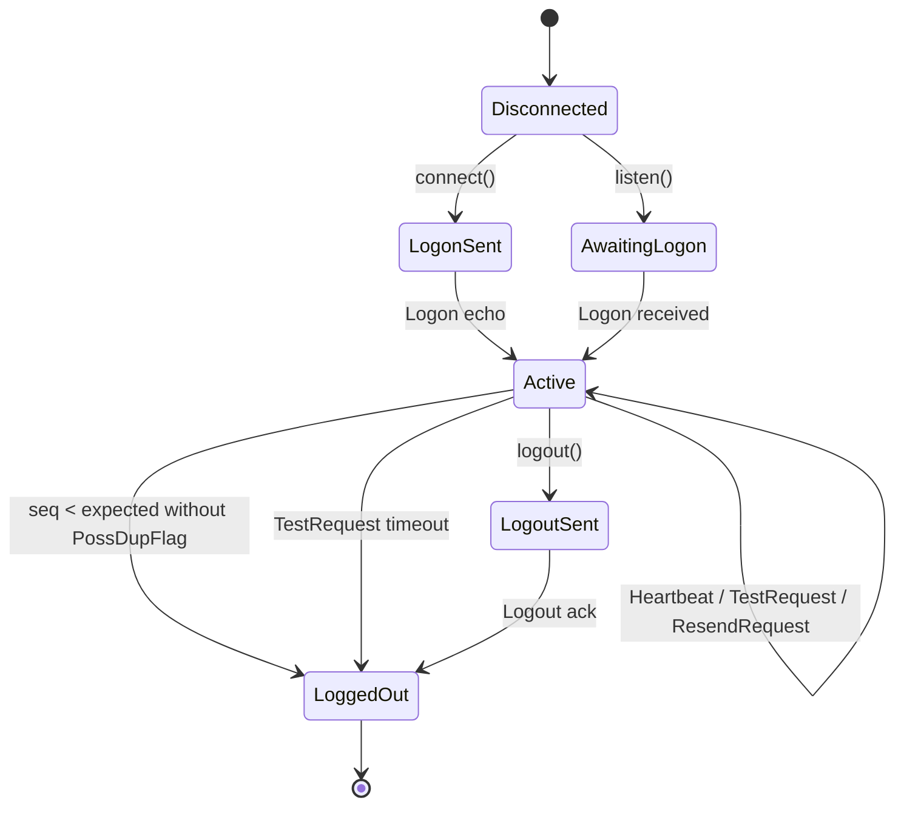

# Architecture

QuantGenLabs is a cross-asset trading, quant and risk platform. This document
describes what exists, how it is layered, and — equally important — what is
deliberately not built yet.

## Layering

Three tiers, separated by what their latency budget is:

The rule that keeps this honest: **nothing in the hot path performs I/O, takes a
lock, or allocates.** Kafka, PostgreSQL and a data lake belong in the warm and cold
tiers, never inside the feed handler. That is spec rule 9, and it is the reason the
C++ layer has no database client in it at all.

## Order lifecycle

Two things this diagram encodes that are easy to get wrong:

- **The ack precedes every fill.** A client that receives a Trade for an order it
  was never told the venue accepted cannot reconcile its blotter.
- **A gap suspends application processing.** Applying a later ExecutionReport
  before an earlier one corrupts position, so the session requests a resend and
  stops rather than processing out of order.

## FIX session state machine

The two edges straight from `Active` to `LoggedOut` are the interesting ones. Both
are cases where the connection is technically fine and the session is nonetheless
unusable: a sequence number going backwards without a duplicate claim means one
side's persisted state is wrong, and silence after a TestRequest means the peer is
gone even though TCP has not noticed.

## Sequence-number handling

The four cases, and why they are handled differently rather than as one
"bad sequence number" branch:

| Inbound | Meaning | Action |
|---|---|---|
| `seq == expected` | in sequence | process, advance |
| `seq > expected` | messages lost | ResendRequest; **suspend app processing** |
| `seq < expected`, no `43` | peer state is wrong | Logout — unrecoverable per spec |
| `seq < expected`, `43=Y` | normal replay during recovery | ignore quietly |

Note that market-data sequencing (`mkt::feed::Validator`) makes a further
distinction FIX does not need: a **duplicate** (same seq again — transport is
retransmitting) versus a **reorder** (older seq after a newer one — transport is
not preserving order). Both are dropped, but they are different diagnoses.

## Component map

| Path | What it is | Tests |
|---|---|---|
| `cpp/include/mkt/book/ladder.hpp` | L2 ladder: integer ticks, flat array, SoA, cached best | 13 |
| `cpp/include/mkt/feed/validator.hpp` | gap/duplicate/reorder/stale/outlier detection | 12 |
| `cpp/include/mkt/fix/message.hpp` | zero-copy FIX parse, allocation-free encode | 14 |
| `cpp/include/mkt/fix/session.hpp` | sequencing, heartbeats, resend, injected clock | 18 |
| `cpp/include/mkt/risk/pretrade.hpp` | kill switch, fat-finger, collars, position limits | 17 |
| `cpp/include/mkt/venue/matching_engine.hpp` | price-time priority, IOC/FOK, self-match prevention | 27 |
| `cpp/include/mkt/venue/fix_venue.hpp` | FIX ↔ matching translation, ExecutionReports | 16 |
| `cpp/include/quant/*` | BSM, binomial, MC, LSM, GARCH, SIMD exp, parallel | 9 |
| `backend/app/core/*` | pricing, risk, OMS, SOR, rates, portfolio, TCA | pytest + Hypothesis |
| `backend/app/core/refdata/symbology.py` | security master; resolution is as-of a date | 10 |
| `backend/app/core/refdata/calendar.py` | trading calendars, sessions, T+2 settlement | 12 |
| `backend/app/core/refdata/corporate_actions.py` | splits/dividends: positions and history together | 9 |
| `backend/app/core/refdata/reconciliation.py` | classified breaks, not a boolean | 12 |
| `backend/app/core/refdata/daily.py` | idempotent SOD/EOD; step order is the correctness | 16 |
| `backend/cryptodesk/*` | crypto venues, OMS, algos, perps, DeFi, vault, wallet | pytest |
| `cpp/src/mkt_bench.cpp` | reproducible benchmark harness → JSON | run in CI |
| `cpp/src/lifecycle_demo.cpp` | the whole path, printed | run in CI |

**197 C++ tests** (`scripts/run_cpp_tests.sh`, no cmake required), **496 Python
tests**, **16 frontend units**, 5 property tests and 3 math verifiers — 709 in
total.

## Reference data

The layer every other subsystem already assumed. It is boring, load-bearing, and
invisible until it is wrong — and when it is wrong the numbers stay plausible,
which is why each module is built around refusing a wrong answer rather than
producing a confident one.

**Resolution is always as-of a date.** A ticker is a display label that exchanges
reuse, not an identifier: when a company delists, its ticker returns to the pool.
`resolve(value, on)` takes the date as a required argument — there is deliberately
no overload that defaults to today, because a ticker resolved against whatever
today happens to be is the wrong answer delivered confidently. Alias windows are
half-open `[from, to)`, so an instrument that changes ticker on a date does not
resolve to both values on that date.

**A trading day is not a calendar day.** T+2 is two *trading* days forward on the
settlement calendar, not `timedelta(days=2)` — a trade on the Thursday before a
Friday holiday settles Tuesday. Half-days are open with an early close, so they
cannot be folded into the holiday set: treating one as closed loses a real
session, treating it as normal leaves an algo working a schedule against a session
that already ended. US holidays are *computed* (including Good Friday via the
Gregorian Easter algorithm and the Saturday→Friday / Sunday→Monday observed rule)
rather than tabulated, so the calendar does not silently expire.

**Corporate actions adjust positions and price history together, or neither.** A
2-for-1 that doubles the share count without back-adjusting history shows a -50%
return on the ex-date that never happened, and every volatility, VaR, beta and
correlation over that window is wrong — silently, because the number is plausible.
`PositionAdjustment.market_value_preserved` is the invariant that catches an
inverted ratio: a split creates nothing, so the position is worth the same either
side of it.

**"They differ" is not a reconciliation result.** Breaks are classified —
`missing_here` (a fill we never received: unhedged risk, critical) vs
`missing_there` (a booking lag, high) vs `quantity` vs `price` vs `sign` (equal
magnitude, opposite direction — the true error is twice the position) vs `timing`
(a cutoff difference, INFO, which does not make the recon dirty). A report that
turns red on every expected cutoff difference is one people stop reading.

**The order of the SOD/EOD steps is the correctness.** Corporate actions before
marking (mark first and a 2-for-1 values 100 shares at the post-split price:
understated by exactly half, and nothing errors); mark before reconciling; roll
last. Every run is keyed by `(business_date, phase)` and a repeat is *refused*,
including after a failure — a retry that reruns the successful steps before hitting
the same failure double-applies them, and a double-applied 10-for-1 gives a 100x
position that looks like a trading error.

Fixtures carry public identifiers only, and every ISIN and CUSIP in them passes
its own check digit (asserted by a test, so they cannot rot into plausible
nonsense). Nothing in the layer is a price.

## Design decisions worth knowing

**Prices are integer ticks, never doubles.** A book keyed by `double` is a latent
correctness bug: 1.10 arrives from one venue as `1.0999999999999999` and from
another as `1.1000000000000001`, and they land on two different levels. Conversion
to display prices happens at the edges only, and it *rounds* — truncating there is
a classic off-by-one-tick bug.

**The order book is a flat array, not a tree.** A live instrument's price range is
bounded over a session, so the whole ladder fits in an array indexed by
`tick - floor`. Every update is an O(1) store rather than an O(log n) tree walk,
and the hot path allocates nothing.

**Time is injected into the session layer.** Every entry point takes `now_ns`, so
heartbeat, test-request and timeout behaviour is tested at exact intervals with no
sleeping. A session that reads its own clock can only be tested by waiting.

**Determinism is a property of the reduction order.** The parallel Monte Carlo
returns bitwise-identical prices at any thread count because per-block RNG
substreams are seeded from `(base_seed, block_index)` and partial sums are reduced
in block-index order. Floating-point addition is not associative, so a fixed
reduction order is what makes results reproducible rather than merely close.

**The matching engine is a test oracle, so it has no clocks, no randomness and no
threads.** The same inbound sequence always produces byte-identical fills.

## What is not built

Stated explicitly rather than implied by absence. See
[`gap-analysis.md`](gap-analysis.md) for the full assessment.

| Not present | Note |
|---|---|
| gRPC | REST and WebSocket only. |
| Redis | No caching tier. |
| Real venue connectivity | FIX targets the in-process simulated venue only, by design (spec rule 6). |
| Model governance | The one piece of §20 still open: no model inventory, validation sign-off or version gating. |
| Load / soak / failure-recovery tests | Correctness and latency are covered; sustained-load and chaos testing are not. |
| Allocation and confirmation | The post-trade path covers reconciliation and settlement dates, not block allocation or affirm/confirm. |

Built, but with a limit worth stating plainly:

| Present | The caveat |
|---|---|
| Kafka event backbone | Topics, partition keys, producer and consumer are real code (`core/events/kafka_bus.py`), and the in-process bus is the runnable fallback. **The Kafka path has never been run against a live broker** — there is none in this environment — so it is written and reviewed, not proven. |
| PostgreSQL | Real schema, Alembic migrations and psycopg3, tested against an embedded PG 16 (`pgserver`) so the constraints are genuinely exercised. Scope is the OMS; **the Crypto Desk stays on SQLite** by requirement. |
| Delta Lake | Real Delta tables via `delta-rs`/pyarrow, bronze/silver/gold. No Spark and no Databricks workspace — the table format is real, the managed platform is not. |
| OpenTelemetry tracing | Spans correlated on ClOrdID with an `X-Trace-Id` response header. Opt-in via `QGL_TRACING`, console exporter by default; no collector deployed. |
| Auth / RBAC | Roles as separations of duty (a TRADER cannot set limits, RISK cannot trade, ADMIN is not a superset), scrypt password hashing, JWT with no default secret. Enforcement is **opt-in** via `QGL_REQUIRE_AUTH` so the demo stays open; Grafana is viewer-anonymous by deliberate choice. |

